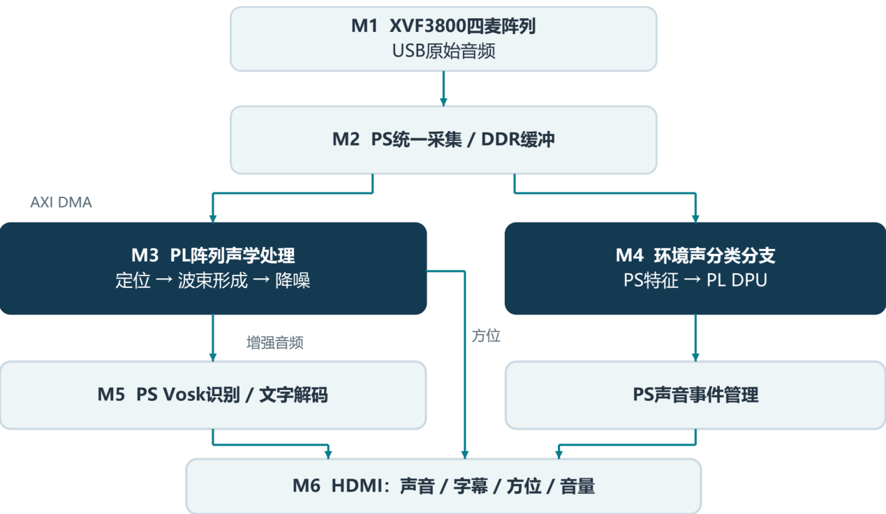

# 声界 · 全离线空间听觉终端

**让重要的声音被看见，让声音的方向更直观。**

声界面向听力障碍者及声音感知受限场景，将声音类别、来源方向、相对音量和文字信息组织在同一 HDMI 界面中，辅助居家生活、公共空间与交通出行中的声音感知。

系统以 **AMD Zynq-7000 / MZ7100FA** 为计算平台，连接 **ReSpeaker XVF3800 四麦克风阵列**、SD 卡与 HDMI 显示器。开发电脑用于训练、构建和维护，终端运行采用本地处理与 SD 自动启动。

## 系统设计

图示采用作品技术报告第 2.1 节的 M1–M6 总体架构：阵列输入进入 PS 采集与 DDR 缓冲，空间声学与环境声分类分支并行，结果汇合到 HDMI 界面。本次源码快照收录采集、DPU 分类、结果管理、显示和启动集成；图中的 M3 阵列声学链及 M5 Vosk 模块实现源码未包含在本次快照中。

环境感知关注周围发生的提示性声音，定向语音增强关注目标方向的交流信息。双分支设计使两类任务共享输入与显示，并保持各自的处理目标。

## 环境声分类

环境声网络使用 `1 × 64 × 96` 声学特征输入，四组卷积与池化的通道数为 `16 → 32 → 64 → 96`，经过 INT8 量化后部署到 PL 侧 DPU。PS 负责特征组织与结果管理。

| 模型类别 | 交互语义 |
|---|---|
| 警笛 | 警笛及报警类声音提示 |
| 车辆鸣笛 | 交通工具鸣笛提示 |
| 门铃 | 访客事件提示 |
| 狗叫 | 周围动物声音提示 |
| 普通说话声 | 日常交流状态 |
| 背景 | 保持简洁，隐藏分类得分 |

训练与验证共使用 **1474 个音频文件**，其中训练集 1160 个、开发验证集 314 个；INT8 校准采用训练集中的 192 个原始音源。类别判定结合模型输出与各类阈值，低于阈值时回到背景状态。

## HDMI 交互

界面将信息固定在四个区域，便于用户持续观察：

- **当前声音与类型条**：显示声音类别和事件状态。
- **文字区域**：固定字幕框，统一呈现文字信息。
- **方位盘**：通过指针表达主声源方向。
- **相对音量条**：通过条形长度表达声音强弱。

普通说话声与提示性事件分开表达，背景状态保持简洁。声音、方向、音量和文字共享一个界面。

## 性能指标

以下数据采用技术报告第 3.3 与 3.8 节的统计口径。

| 项目 | 结果 | 统计范围 |
|---|---|---|
| 声学采样率 | 16 kHz | 音频处理配置 |
| 分类准确率 | 79.94%（251 / 314） | 开发验证窗口，用于模型选择和阈值调整 |
| 宏平均召回率 | 73.58% | 同一开发验证集的六类结果 |
| DPU 配置 | 单核 B1152F，150 MHz | 已部署 DPU 平台 |
| DPU 调用耗时 | 中位数 0.653 ms；P95 1.003 ms | 436 次 `dpuRunTask` 调用，不含前后处理 |
| 声音结果更新 | 约 2 次 / 秒 | 1 秒分析窗，0.5 秒更新步长 |
| 接收窗口后软件处理 | 中位数 440 ms | 不含音频窗口积累及显示器响应 |
| HDMI 输出 | 1280 × 720 | 显示平台 |

展开：FPGA 资源与时序

统计对象是 Vivado 2017.4、XC7Z100-2FFG900 上的 **SJEM1 DPU＋HDMI 基础平台**，不合并其他版本的声学模块。

| 资源 | 已用 / 可用 | 占用率 |
|---|---:|---:|
| LUT | 35,682 / 277,400 | 12.86% |
| FF | 77,318 / 554,800 | 13.94% |
| BRAM（36 Kb 等效） | 127.5 / 755 | 16.89% |
| DSP48E1 | 211 / 2,020 | 10.45% |

总线时钟为 142.857 MHz，DPU 主时钟 / 双倍频为 150 / 300 MHz，HDMI 像素时钟为 74.286 MHz。已约束路径的 WNS 为 +0.254 ns、WHS 为 +0.029 ns，TNS / THS 均为 0。I/O 另有未约束端点，因此这里仅报告已约束路径结果。

## 源码导航

| 目录 | 内容 |
|---|---|
| `src/` | 音频输入、特征、分类、结果管理、方向接口与 HDMI 绘制 |
| `scripts/host/` | 数据处理、训练、量化、构建、部署与验证工具 |
| `scripts/guest/`、`scripts/board/` | ARM 构建与板端运行工具 |
| `scripts/vivado/`、`constraints/`、`hardware/` | PL 集成、约束、BD 与实现报告 |
| `models/release/` | 训练权重、部署网络、DPU ELF 与阈值 |
| `config/` | 模型、平台与运行配置 |
| `assets/` | 界面及运行资源 |
| `tests/` | 软件与接口测试源码 |

阅读 [构建说明](docs/BUILD.md)、[指标说明](docs/METRICS.md) 和 [第三方依赖](THIRD_PARTY_NOTICES.md)。`SOURCE_SNAPSHOT.json` 记录本次发布来源，`SHA256SUMS` 提供文件校验。
